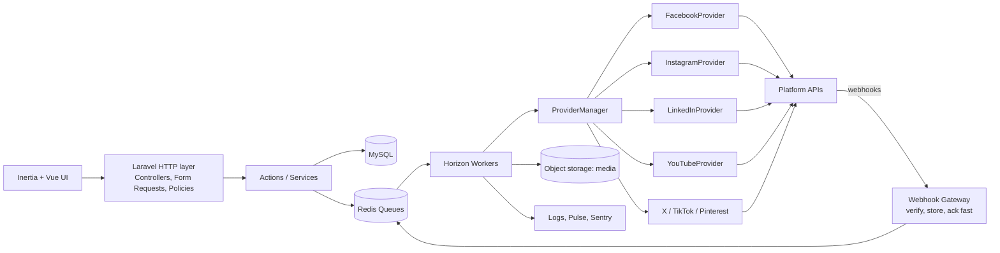
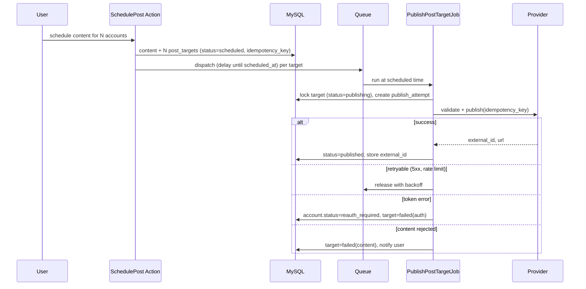

# Architecture

## 1. Goals
- Add platforms by writing **one provider class + config**, not by touching core code.
- Never lose or double-publish a post.
- Survive platform outages, token expiry, and rate limits gracefully.
- Keep the existing Facebook code working during the migration.

## 2. High-level diagram



## 3. Layers

| Layer | Responsibility | Rules |
|---|---|---|
| HTTP | Controllers, Form Requests, Policies, Inertia pages | Thin. No platform calls. |
| Actions | `SchedulePost`, `ConnectAccount`, `ReplyToConversation` | One public `handle()`; transactional |
| Domain models | Eloquent models, enums, value objects | No HTTP |
| Providers | Platform adapters implementing contracts | Only place that knows platform specifics |
| Jobs | Publish, refresh token, sync inbox, pull metrics | Idempotent, retry-safe |
| Webhook gateway | Verify signature, persist raw event, dispatch | Respond < 2s |

## 4. Suggested directory layout

```
app/
  Actions/
    Accounts/ConnectAccount.php
    Posts/SchedulePost.php
    Posts/PublishPostTarget.php
  Contracts/Social/
    SocialProvider.php
    SupportsMessaging.php
    SupportsComments.php
    SupportsAnalytics.php
    SupportsWebhooks.php
  DTO/Social/
    ProviderCapabilities.php  TokenSet.php  PublishResult.php
    NormalizedEvent.php  NormalizedMetric.php  MediaSpec.php
  Enums/  Provider.php  AccountKind.php  PostStatus.php  ErrorClass.php
  Jobs/Social/
    PublishPostTargetJob.php  RefreshAccountTokenJob.php
    SyncInboxJob.php  PullMetricsJob.php  ProcessWebhookEventJob.php
  Models/  Workspace.php SocialAccount.php Content.php PostTarget.php ...
  Services/Social/
    ProviderManager.php  RateLimiter.php  CircuitBreaker.php  TokenVault.php
    Providers/
      Facebook/  Instagram/  Threads/  LinkedIn/  YouTube/  X/  TikTok/  Pinterest/
      Fake/FakeProvider.php
  Http/Controllers/Webhooks/{Meta,LinkedIn,YouTube}WebhookController.php
config/social.php
```

## 5. Provider contract

```php
interface SocialProvider
{
    public function key(): string;                       // 'facebook', 'linkedin', ...
    public function capabilities(): ProviderCapabilities; // limits & supported features

    // Auth
    public function authorizationUrl(AuthState $state): string;
    public function handleCallback(array $query, AuthState $state): ConnectionResult;
    public function refreshToken(SocialAccount $account): TokenSet;
    public function revoke(SocialAccount $account): void;

    // Publishing
    public function validate(PostTarget $target): ValidationResult; // pre-flight
    public function publish(PostTarget $target, string $idempotencyKey): PublishResult;
    public function delete(PostTarget $target): void;
}

interface SupportsMessaging { public function sendMessage(Conversation $c, OutboundMessage $m): void; }
interface SupportsComments  { public function replyToComment(Comment $c, string $text): void;
                              public function setCommentVisibility(Comment $c, bool $hidden): void; }
interface SupportsAnalytics { public function fetchMetrics(SocialAccount $a, DateRange $r): iterable; }
interface SupportsWebhooks  { public function verify(Request $r): bool;
                              public function normalize(Request $r): iterable; /* NormalizedEvent[] */ }
```

`ProviderCapabilities` example:

```php
new ProviderCapabilities(
  text: true, images: true, video: true, carousel: true, link: true,
  maxTextLength: 3000, maxImages: 20, maxVideoSeconds: 900,
  supportsNativeScheduling: false,   // if false, WE schedule via queue
  supportsMessaging: false, supportsComments: true, supportsAnalytics: true,
)
```

The composer UI reads these capabilities to validate content **before** scheduling.

## 6. Publishing pipeline



### Rules
- **Idempotency:** `post_targets.idempotency_key` (ULID). Before calling a provider, check `external_id` is null. If a provider supports idempotency headers, send the key. Otherwise, on retry after an ambiguous failure, first *look up* recent posts to detect a successful earlier attempt.
- **Locking:** `UPDATE ... WHERE status='scheduled'` atomic claim, or `Cache::lock("target:{$id}")`.
- **Error classes** (`ErrorClass` enum): `Retryable`, `RateLimited`, `AuthExpired`, `PermissionMissing`, `ContentRejected`, `Fatal`. Providers map raw API errors into these.
- **Backoff:** 30s, 2m, 10m, 30m, 2h, then fail. `RateLimited` honors `Retry-After` / provider reset time.
- **Scheduling:** if the platform lacks reliable native scheduling, schedule in our queue. For YouTube, use `status.publishAt` (upload early, publish later).
- **Missed schedules:** a minutely sweeper command finds `scheduled` targets past due and re-dispatches them (protects against Redis flush or worker downtime).

## 7. Queues & Horizon supervisors

| Queue | Purpose | Concurrency | Timeout |
|---|---|---|---|
| `publish` | Post publishing | 5–10 | 120s |
| `media` | Upload/transcode/validate | 2–4 | 900s+ |
| `webhooks` | Process stored events | 5 | 60s |
| `inbox` | Sync messages/comments | 3 | 120s |
| `metrics` | Pull analytics | 2 | 300s |
| `maintenance` | Token refresh, cleanup | 1 | 120s |

Use `ShouldBeUnique` for token refresh and metrics jobs per account.

## 8. Rate limiting & circuit breaker
- Redis token bucket per `(provider, account)` and per app (global). Limits come from `config/social.php`.
- Read platform usage headers (e.g., Meta `X-App-Usage` / `X-Business-Use-Case-Usage`, Google quota errors) and slow down at ~80% usage.
- **Circuit breaker:** after N consecutive 5xx/timeouts for a provider, open the circuit for a cool-off period; jobs release back to the queue instead of hammering a failing API.
- **YouTube quota ledger:** track units spent per day per Google Cloud project; refuse new uploads when the remaining budget is too low and notify the user.

## 9. Webhooks
1. Route: `POST /webhooks/{provider}` (plus `GET` for verification handshakes where required).
2. Verify signature using the **raw body** (never the parsed JSON).
3. Insert into `webhook_events` with a unique `(provider, external_event_id)` or a hash of the payload; ignore duplicates.
4. Return `200` immediately; process in `ProcessWebhookEventJob`.
5. Provider `normalize()` converts to `NormalizedEvent` (type: `message.received`, `comment.created`, `post.deleted`, `account.deauthorized`...).
6. Handlers (inbox, rules engine, account status) subscribe to normalized events only.

For platforms with weak/no webhooks (LinkedIn for many cases, X on lower tiers), use scheduled **polling** jobs with cursors stored on the account.

## 9b. Unified inbox
`conversations` (thread with a person on one account) → `messages`; `comments` hang off `post_targets`. Rules engine evaluates normalized events: match (keyword / regex / intent / first-message) → action (reply, assign, tag, hide, notify). Always check the platform's messaging window and policy before auto-replying.

## 10. Media pipeline
1. Upload via signed URL/chunked endpoint to S3-compatible storage.
2. `media` job probes the file (ffprobe): duration, codec, dimensions, size.
3. Store derived specs in `media_assets.meta`; composer validates against capabilities.
4. At publish time, providers either pass a public/pre-signed URL (Meta) or stream chunks (YouTube resumable, LinkedIn upload URLs, TikTok chunks).
5. Lifecycle rule deletes orphaned or old temporary media.

## 11. Multi-tenancy
Single database, `workspace_id` on every tenant table, enforced by a global scope + policies. Optionally `spatie/laravel-multitenancy` later; do not over-engineer now.

## 12. Frontend structure (Inertia + Vue 3 + TS)
```
resources/js/
  Pages/ Accounts/ Composer/ Calendar/ Inbox/ Analytics/ Settings/
  Components/ PlatformBadge.vue  MediaPicker.vue  PlatformPreview/*.vue
  Composables/ useCapabilities.ts  usePublishStatus.ts
  Types/ social.d.ts   // generated from PHP enums/DTOs where possible
```
Realtime status (publishing → published/failed) via Laravel Reverb or polling every few seconds.

## 13. Configuration (`config/social.php`) shape
```php
return [
  'providers' => [
    'facebook' => ['client_id'=>env('META_APP_ID'), 'client_secret'=>env('META_APP_SECRET'),
                   'api_version'=>env('META_GRAPH_VERSION'), 'scopes'=>[...], 'rate'=>['per_minute'=>120]],
    'linkedin' => ['client_id'=>..., 'client_secret'=>..., 'api_version'=>env('LINKEDIN_API_VERSION'), 'scopes'=>[...]],
    'youtube'  => ['client_id'=>..., 'client_secret'=>..., 'daily_quota'=>10000, 'scopes'=>[...]],
  ],
];
```
Platform versions are **config, not constants**, so upgrades are an env change plus tests.

## 14. Decisions & trade-offs
| Decision | Why |
|---|---|
| Provider pattern over per-platform modules | Uniform composer, inbox, analytics, tests |
| Own scheduling for most platforms | Native scheduling is inconsistent or missing |
| Raw webhook storage before processing | Replay, debugging, idempotency |
| Normalized metrics table | Charts work across platforms; mapping is per-provider |
| Config-driven scopes/versions | Avoid redeploys for platform churn |
