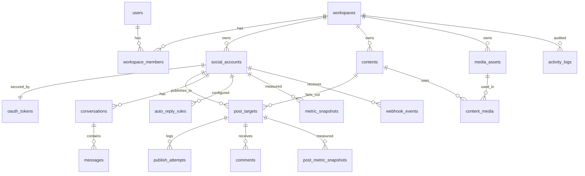

# Database Design (MySQL 8)

Conventions: `id` BIGINT unsigned PK, `ulid` public identifier where exposed, `created_at/updated_at`, soft deletes only where noted. All tenant tables carry `workspace_id` with FK + index. Use `utf8mb4`. JSON columns for provider-specific extras only.

## ERD

## Tables

### users / workspaces
| Table | Key columns |
|---|---|
| `users` | id, name, email (unique), password, two_factor_secret (encrypted), two_factor_confirmed_at, locale, timezone, last_login_at |
| `workspaces` | id, ulid, name, slug (unique), timezone, plan, owner_id FK users |
| `workspace_members` | id, workspace_id FK, user_id FK, role ENUM(owner,admin,editor,viewer), invited_by, accepted_at. UNIQUE(workspace_id,user_id) |
| `workspace_invitations` | id, workspace_id, email, role, token_hash, expires_at |

### social_accounts (replaces `facebook_pages`)
| Column | Type | Notes |
|---|---|---|
| id | bigint PK | |
| workspace_id | FK | |
| connected_by | FK users | |
| provider | varchar(32) | enum: facebook, instagram, threads, linkedin, youtube, x, tiktok, pinterest |
| kind | varchar(24) | page, profile, channel, organization, business |
| external_id | varchar(191) | platform account/page/channel id |
| parent_account_id | FK null | e.g., Instagram account linked to a Facebook Page |
| name, username, avatar_url | | cached display data |
| status | ENUM | active, reauth_required, paused, revoked, error |
| capabilities | json | snapshot of granted scopes/features |
| settings | json | per-account preferences |
| last_synced_at, last_error, last_error_at | | |
| token_expires_at | datetime idx | denormalized for expiry alerts |
| UNIQUE | (workspace_id, provider, external_id) | |

### oauth_tokens (token vault)
| Column | Notes |
|---|---|
| social_account_id FK UNIQUE | one active token set per account |
| access_token | `encrypted` cast (long TEXT) |
| refresh_token | encrypted, nullable |
| token_type, scopes (json) | |
| expires_at, refresh_expires_at | |
| key_version | smallint, for key rotation |
| rotated_at | |

> Keep tokens in a **separate table** so they are never accidentally serialized with the account model. Add `$hidden` and never eager-load this relation by default.

### Content & publishing
| Table | Key columns |
|---|---|
| `contents` | id, ulid, workspace_id, author_id, title, body (text), link_url, status ENUM(draft,pending_approval,approved,scheduled,partial,published,failed), scheduled_at (UTC), timezone, approval_by, approved_at, tags json, ai_generated bool |
| `media_assets` | id, workspace_id, uploader_id, disk, path, mime, size_bytes, width, height, duration_ms, checksum_sha256, meta json, status(uploading,ready,failed) |
| `content_media` | content_id, media_asset_id, position, alt_text. PK(content_id, media_asset_id) |
| `post_targets` | id, ulid, content_id FK, social_account_id FK, status ENUM(scheduled,queued,publishing,published,failed,cancelled), body_override, options json (title, privacy, hashtags, first_comment, category...), scheduled_at (UTC), published_at, external_id, external_url, idempotency_key (unique), attempts tinyint, error_class, error_message, version int |
| `publish_attempts` | id, post_target_id FK, attempt_no, started_at, finished_at, outcome, http_status, error_class, provider_request_id, response_excerpt (redacted) |

Indexes: `post_targets(status, scheduled_at)` (sweeper), `post_targets(social_account_id, published_at)`, `post_targets(external_id, social_account_id)`.

### Inbox
| Table | Key columns |
|---|---|
| `conversations` | id, workspace_id, social_account_id, external_id, participant_external_id, participant_name, status(open,closed,snoozed), assigned_to, last_message_at, window_expires_at (messaging window), unread_count. UNIQUE(social_account_id, external_id) |
| `messages` | id, conversation_id, external_id, direction(in,out), body, attachments json, sent_by_user_id null, is_auto_reply bool, delivered_at, status. UNIQUE(conversation_id, external_id) |
| `comments` | id, post_target_id null, social_account_id, external_id, parent_external_id, author_external_id, author_name, body, is_hidden, replied_at, sentiment null, created_at_platform. UNIQUE(social_account_id, external_id) |

### Automation
| Table | Key columns |
|---|---|
| `auto_reply_rules` | id, workspace_id, social_account_id null (null = all), trigger ENUM(message,comment), match_type(contains,exact,regex,first_message,any), patterns json, action ENUM(reply,hide,delete,assign,tag,notify), reply_template (text), priority, cooldown_seconds, active, stats json |
| `rule_executions` | id, rule_id, event_ref, result, created_at (for cooldown + audit) |
| `saved_replies` | id, workspace_id, title, body, shortcut |

### Webhooks
`webhook_events`: id, provider, social_account_id null, external_event_id null, payload_hash (char 64), payload (JSON, raw), signature_valid bool, status(received,processed,ignored,failed), received_at, processed_at, error. UNIQUE(provider, payload_hash) or (provider, external_event_id). Prune after 30–90 days.

### Analytics
| Table | Key columns |
|---|---|
| `metric_definitions` | key (e.g., `impressions`, `reach`, `followers`, `engagements`, `video_views`, `watch_time`), unit, aggregation |
| `metric_snapshots` | id, social_account_id, metric_key, date, value (decimal/bigint), raw json. UNIQUE(social_account_id, metric_key, date) |
| `post_metric_snapshots` | id, post_target_id, metric_key, captured_at, value. INDEX(post_target_id, metric_key, captured_at) |

Each provider maps its native metrics to `metric_key`. Unsupported metrics are simply absent (never fake zeros).

### Platform / ops
| Table | Key columns |
|---|---|
| `activity_logs` | id, workspace_id, actor_id null, subject_type, subject_id, event, properties json, ip, user_agent, created_at. Append-only. |
| `api_call_logs` | id, provider, social_account_id, endpoint (no tokens/query secrets), method, status, duration_ms, request_id, rate_usage json, created_at. Partition by month or prune at 30 days |
| `quota_usage` | provider, scope_key (e.g., GCP project), date, units_used. UNIQUE(provider, scope_key, date) |
| `api_keys` | (optional public API) id, workspace_id, name, token_hash, abilities json, last_used_at |
| `outbound_webhooks` | (optional) workspace_id, url, secret (encrypted), events json |
| `notifications` | Laravel default |

## Indexing & performance notes
- Partition or prune `api_call_logs`, `webhook_events`, `publish_attempts` aggressively.
- Always store datetimes in UTC; keep user timezone on `contents`/`users` for display.
- Use `ulid` in URLs/APIs; never expose auto-increment ids.
- Use `decimal`/`bigint` for metrics; avoid floats.
- Add composite FKs sparingly; enforce workspace consistency in policies and with tests.
- Run `EXPLAIN` on sweeper query: `WHERE status='scheduled' AND scheduled_at <= NOW()`.

## Migration order
1. users additions → 2. workspaces + members → 3. social_accounts + oauth_tokens → 4. media → 5. contents/post_targets/attempts → 6. inbox → 7. rules → 8. webhook_events → 9. metrics → 10. logs/ops. See `MIGRATION_FROM_FACEBOOK.md` for backfill from `facebook_pages`, `posts`, `scheduled_posts`, `messages`, `insights`.
